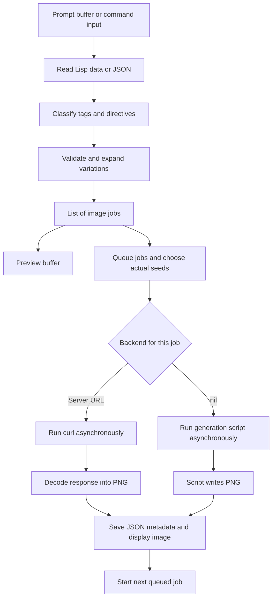
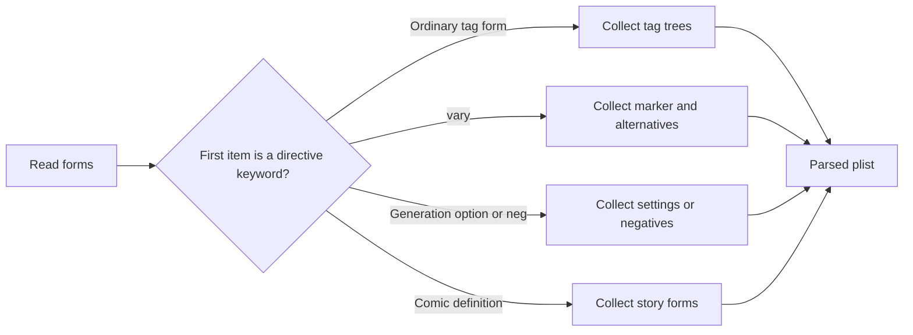
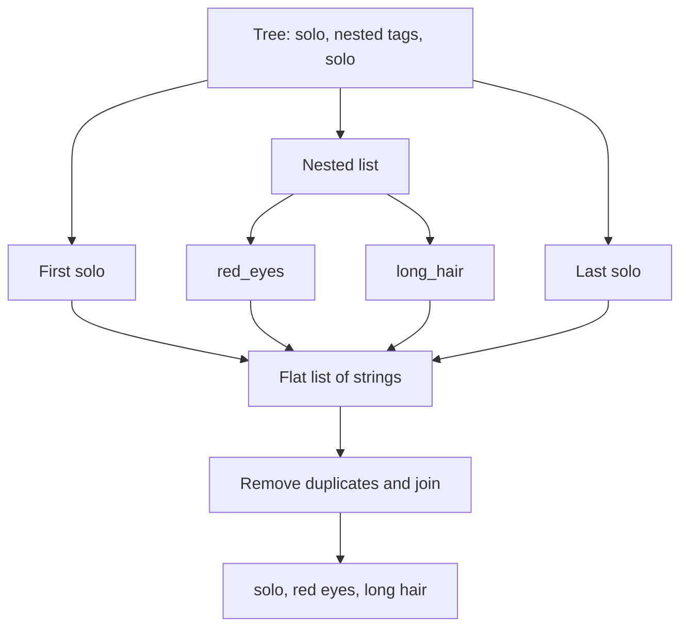
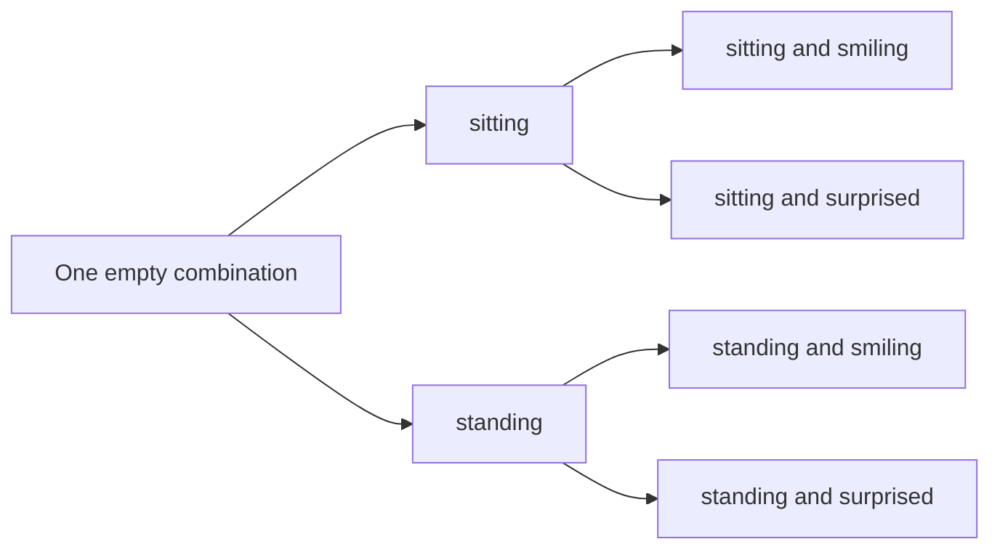
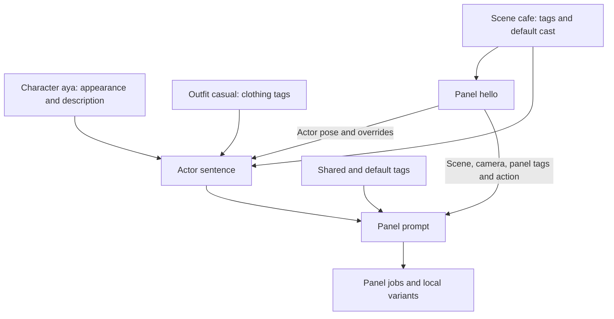
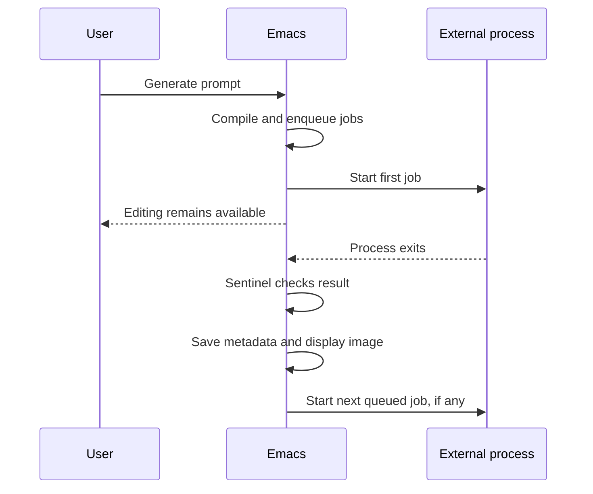

# Understanding `danbooru.el`

`danbooru.el` connects an Emacs editing buffer to an external image generator. You write tags and settings as data, and the package turns them into text prompts, runs generation jobs, and displays the resulting images.

This note explains the implementation for someone learning **Emacs Lisp**. Read it alongside [the source](danbooru.el). For a guide focused on writing comic prompts, see [[danbooru-manga]].

For researched Anima prompting guidance and the `:caption` and `:artist`
extensions, see [Writing Anima prompts](danbooru-anima.md).

> [!abstract] The central idea
> The package first **compiles text into jobs**, then **executes those jobs**. A job is ordinary Lisp data describing one image request. Separating these stages makes previewing and testing possible without generating images.

## 1. See the whole program first



The image model lives outside Emacs. This file handles editing, data transformation, process management, and display.

The most useful entry points are:

| Function | Responsibility |
| --- | --- |
| `danbooru-edit-prompt` | Open the configured prompt file, inserting a starter prompt when the buffer is empty. |
| `danbooru--expand` | Compile prompt text into a list of jobs. |
| `danbooru--preview` | Show those jobs' prompts without contacting the backend. |
| `danbooru-generate` | Compile the input and hand the jobs to the queue. |
| `danbooru--start-next` | Start one job and install its completion callback. |
| `danbooru-show` | Display an image and remember its source in that buffer. |

The double hyphen in names such as `danbooru--expand` conventionally marks an internal helper. It does not prevent you from calling the function while studying the package.

## 2. Lisp syntax you need for this file

### Calls, symbols, strings, and quoted data

In Lisp, a function call puts the function name first:

```elisp
(+ 2 3)                         ; => 5
(string-replace "_" " " "red_eyes") ; => "red eyes"
```

Emacs evaluates the arguments before calling an ordinary function. A bare symbol normally asks for a variable's value:

```elisp
(setq colour "red")
colour                          ; => "red"
"colour"                        ; => "colour"
'colour                         ; => the symbol colour
'(red_eyes long_hair)            ; => a list containing two symbols
```

The apostrophe is shorthand for `quote`. It tells the evaluator to treat the following expression as data. Keywords such as `:seed` evaluate to themselves and commonly serve as field names.

`nil` is both false and the empty list. Every other value is true, including `0` and `""`. This matters when the queue accepts seed `0` as a valid fixed seed.

### Prompt data is read, not evaluated

A `.danbooru` file can contain:

```lisp
(1girl (long_hair red_eyes) $POSE)
(:vary $POSE sitting standing)
(:seed 42)
```

You do **not** put an apostrophe before each prompt form. `danbooru--read-forms` uses `read`, which converts characters into Lisp objects. It does not evaluate them as function calls.

```elisp
(read "(red_eyes long_hair)")     ; => (red_eyes long_hair)
'(red_eyes long_hair)             ; => the same list
```

Likewise, `$POSE` has no built-in special meaning in Lisp. This package interprets its name as a substitution marker. `:vary` is a keyword that the parser recognizes as a directive.

> [!tip] Distinguish the two languages
> `danbooru.el` is executable Emacs Lisp. A `.danbooru` file is a small language built from Lisp data. For example, `(+ 2 3)` in a prompt does not calculate `5`; the legacy flattener treats its contents as tags.

### How to read a function definition

Here is the actual `danbooru--join` function:

```elisp
(defun danbooru--join (tags)
  "Return TAGS without duplicates joined with commas."
  (string-join (delete-dups (copy-sequence tags)) ", "))
```

Read it from the inside out:

1. `copy-sequence` makes a shallow copy of the list.
2. `delete-dups` removes duplicate elements from that copy.
3. `string-join` joins the remaining strings with `", "`.

The last expression's value becomes the function's return value. An explicit `return` is unnecessary.

The copy matters because `delete-dups` can modify the list it receives. This helper avoids modifying the caller's list structure.

### Local variables and control flow

These constructs recur throughout the source:

| Construct | Meaning |
| --- | --- |
| `let` | Introduce local bindings. Initial values are evaluated before the new bindings take effect. |
| `let*` | Introduce bindings in order, letting later ones use earlier ones. |
| `setq` | Assign a value to a variable. |
| `if` | Choose between a true branch and a false branch. |
| `when` / `unless` | Run a body when a condition is true / false. |
| `cond` | Try conditions in order and use the first matching branch. |
| `pcase` | Choose a branch by matching values or patterns. |
| `progn` | Group expressions together and return the last value. |
| `dolist` | Run a body for every item in a list. |
| `mapcar` | Apply a function to each item and collect the return values. |
| `lambda` | Create an anonymous function. |
| `&optional` / `&rest` | Accept optional arguments / collect remaining arguments into a list. |

For example, this expression extracts every job's prompt:

```elisp
(mapcar (lambda (job) (plist-get job :prompt)) jobs)
```

`#'string<` means “use the function named `string<`.” The package uses it to sort completion candidates alphabetically.

## 3. The data structures carrying the program

### Lists, cons cells, and association lists

A list is built from linked pairs called **cons cells**. `car` gets the first part and `cdr` gets the rest:

```elisp
(car '(red blue green))          ; => red
(cdr '(red blue green))          ; => (blue green)
(cadr '(red blue green))         ; => blue
(cddr '(red blue green))         ; => (green)
```

`cadr` means `car` of `cdr`; `cddr` means `cdr` of `cdr`.

An **association list**, or alist, stores key/value entries:

```elisp
'(("$POSE" . sitting)
  ("$FACE" . smiling))
```

The dot means the entry is a pair with that value directly in its `cdr`. These pairs need not be two-element lists.

```elisp
(assoc "$POSE" '(("$POSE" . sitting))) ; => ("$POSE" . sitting)
```

The package uses `assoc` for string marker names, which need value comparison. It uses `assq` for interned symbol names such as `aya`, which can be compared by identity.

### Property lists

A **property list**, or plist, alternates field names and values:

```elisp
'(:prompt "solo, long hair"
  :seed 42
  :params (:model "turbo" :width 1200 :height 1200))
```

Access and update fields with:

```elisp
(plist-get job :seed)
(setq job (plist-put job :seed 99))
```

Keeping the result of `plist-put` matters: adding a property can change the list's head.

Both “absent property” and “property whose value is `nil`” return `nil` from `plist-get`. Use `plist-member` to distinguish them. The comic compiler relies on this distinction:

- Omit `:actors` to include the scene's cast.
- Supply `:actors ()` to request no actors.
- Supply `:cfg nil` to leave CFG to the backend, even if a previous layer supplied a number.

### Accumulating lists

`push` puts an item at the front of a list. `pop` removes and returns the front item. `append` joins lists.

The reader repeatedly uses `push`, then `nreverse`, to recover the original order:

```text
Read A, B, C
After pushing: (C B A)
After reversing: (A B C)
```

`nreverse` can modify the list structure. Here the function owns the temporary accumulator, so reversing it in place is appropriate.

## 4. Settings, state, and dependencies

At the top of the file, `require` loads supporting libraries: `cl-lib` provides constructs such as `cl-loop`, `subr-x` supplies string helpers, and `json` handles JSON conversion. Other libraries support completion, URL parsing, Lisp editing, and navigation.

At the bottom, `(provide 'danbooru)` announces that the feature has loaded. Another file can then use `(require 'danbooru)` when the library is on `load-path`.

The definitions fall into different categories:

| Form | Examples | Purpose |
| --- | --- | --- |
| `defgroup` | `danbooru` | Group settings in Emacs Customize. |
| `defcustom` | `danbooru-server`, `danbooru-width` | Define user settings with documentation and customization types. |
| `defvar` | `danbooru--queue`, `danbooru--process` | Define variables for shared runtime state. |
| `defvar-local` | `danbooru-source`, `danbooru-panel` | Give each buffer its own value when assigned there. |
| `defconst` | `danbooru--directives` | Declare a value intended to stay constant. |

`defcustom` describes a setting's expected type for Customize; the package separately validates generation parameters in its compiler. `defconst` expresses intent rather than making mutation impossible.

The current defaults include `"turbo"`, dimensions `1200 × 1200`, seed `-1`, and a non-nil server URL. A seed of `-1` requests randomness. `nil` steps and CFG leave those settings to the backend. Check the source for your actual paths and server address.

Buffer-local source metadata means two open image buffers can remember different prompts. The queue is shared across buffers, so generation requests join the same sequence of jobs.

## 5. Reading and parsing the input

`danbooru--read-forms` uses a temporary buffer:

1. Insert the source text.
2. Move to the beginning with `goto-char` and `point-min`.
3. Install the Emacs Lisp syntax table.
4. Skip comments and whitespace with `forward-comment`.
5. Repeatedly call `read` and collect the forms.
6. Reverse the collection into source order.

An Emacs **buffer** holds text. **Point** is its cursor position. `with-temp-buffer` creates a temporary working buffer and discards it afterward. `with-current-buffer` runs code in an existing buffer.

`condition-case` catches errors. The reader converts incomplete or invalid forms into `user-error` messages containing the form's starting line. `user-error` signals a problem with the user's input.

`danbooru--parse` chooses the input format by inspecting the beginning of the text. A leading `[` or `{` after spaces, tabs, or newlines selects JSON; otherwise it reads Lisp forms. `danbooru--json-forms` converts supported JSON into forms the same parser can process.

For example, these inputs express the same legacy prompt:

```lisp
(solo long_hair)
(:seed 42)
```

```json
{"tags": ["solo", "long hair"], "seed": 42}
```

JSON tag values are strings, so they follow the flattener's string rules: `"long_hair"` stays `"long_hair"`. An unquoted Lisp symbol `long_hair` becomes `"long hair"`. The JSON path supports legacy tags and options; it does not implement JSON character/scene/panel definitions.

The parser separates ordinary tag forms from recognized directives:



An unknown keyword directive produces an error. A simplified parsed result looks like:

```elisp
(:tags ((solo $POSE))
 :vary (("$POSE" sitting standing))
 :story nil
 :seed 42)
```

In the source, `pcase-dolist` patterns such as `` `(,marker . ,vals) `` unpack each alist entry into variables. The backtick and commas here belong to the pattern syntax; they are not prompt substitutions.

## 6. Flattening: recursion turns a tree into tags

`danbooru--flatten` returns a **list of strings**. `danbooru--join` later turns that list into a single prompt string.

The flattener examines the input's type with `cond`:

| Input | Result |
| --- | --- |
| `nil` | No tags. |
| Cons cell / list | Recursively flatten its first part and its remaining part; append the results. |
| Vector | Convert to a list and flatten it. |
| Symbol | Substitute a matching marker, or convert its name into a tag. |
| String | Substitute markers inside it, trim outside whitespace, keep the remaining string together. |
| Other atom | Convert it to text with `format`. |

The legacy flattener also skips reader wrappers for quote, backquote, and commas. Comic tag validation is stricter about accepted data.

Consider:

```elisp
(danbooru--flatten '(solo (red_eyes long_hair) solo))
;; => ("solo" "red eyes" "long hair" "solo")

(danbooru--join '("solo" "red eyes" "long hair" "solo"))
;; => "solo, red eyes, long hair"
```



This is **recursion**: the function handles a small part of the structure by calling itself on smaller structures. Atoms and `nil` are stopping cases.

`danbooru--tag-name` lowercases symbol tags by default and changes underscores to spaces, except names beginning with `score_` or `$`. Variation markers retain their case. Quoted strings retain their capitalization and underscores. Joining removes duplicate complete strings, not individual words or comma-separated fragments inside one string. The explicit `(:artist ...)` wrapper is an exception: it normalizes its names and adds `@`. `:caption` strings are compiled separately from tags and appended as sentences; legacy prompts use newlines between these sections.

### Substitution and cycle detection

The optional `subst` argument is an alist of marker/value pairs:

```elisp
(danbooru--flatten '(solo $POSE)
                    '(("$POSE" . (sitting seiza))))
;; => ("solo" "sitting" "seiza")
```

A replacement can contain another marker. The optional `resolving` argument tracks the markers currently being expanded. Encountering a marker already on that path reports a cycle instead of recurring forever.

For a string such as `"A person is $POSE"`, the replacement's tags are joined before insertion into that sentence.

## 7. Variations produce combinations of jobs

For legacy prompts, `danbooru--expand-legacy` creates one job for every combination of variation values:

```lisp
(solo $POSE $FACE)
(:vary $POSE sitting standing)
(:vary $FACE smiling surprised)
(:seed 42)
```



Two choices times two choices produce four jobs:

```text
solo, sitting, smiling
solo, sitting, surprised
solo, standing, smiling
solo, standing, surprised
```

The nested `cl-loop` expressions build this **Cartesian product**. Each iteration extends every existing combination with each value from the next variation.

The result is a list of plists containing `:label`, `:prompt`, `:seed`, and `:params`. No external process has started yet.

## 8. Comic compilation resolves named definitions

When parsed `:story` data exists, `danbooru--expand` uses `danbooru--expand-story` instead of the legacy compiler.

A small complete example:

```lisp
(:defaults :tags (manga) :seed 42)
(:character aya :description "A woman" :tags (long_hair))
(:outfit casual :tags (sweater))
(:scene cafe :tags (indoors) :cast ((aya :outfit casual)))
(:panel hello :scene cafe :actors ((aya :pose (smiling))))
```

It compiles to this prompt:

```text
manga, indoors. 1 person. A woman: long hair, sweater, smiling.
```



`danbooru--story` first collects named definitions into alists, then validates their references. This allows a panel to refer to a scene defined later in the file. Panels are restored to source order before compilation.

The compiler validates property names, duplicate definitions, actor references, parameter values, and variation data. It checks every scene's cast, including scenes unused by panels. It does not check tag spelling against the completion vocabulary.

Each actor is rendered separately by `danbooru--actor-prompt`. It combines character appearance, outfit, pose, expression, and actor tags. Deduplication happens inside that actor's sentence, so two people can each retain a clothing tag such as `boots`.

The panel's actor properties override the scene's outfit defaults. `:outfit nil` explicitly removes that default. Omitting `:actors` uses the cast; an empty `:actors` produces `"No people."`.

### Overriding settings

For comic generation options, later layers take precedence:


`danbooru--merge-properties` walks the layers and repeatedly uses `plist-put`. Explicit `nil` values survive the merge; `plist-member` preserves their meaning when resolving steps and CFG. Legacy steps and CFG use `or`, so explicit `nil` there falls back to the Emacs setting.

Tags and negative prompts are combined across their relevant layers rather than replaced like generation options. Comic `:vary` belongs inside a panel, and variants only multiply that panel's jobs.

Selecting one panel happens **after** the full story has been compiled. An error in another panel can therefore prevent the selected panel from generating. Unresolved placeholders in comic prompts and negative prompts are errors; legacy expansion does not perform that final unresolved-marker check.

## 9. The queue adds execution details

`danbooru-generate` is a short bridge between the compiler and runner:

```elisp
(danbooru--enqueue-jobs (danbooru--expand text panel) text seed)
```

`danbooru--enqueue-jobs` adds fields such as:

| Field | Meaning |
| --- | --- |
| `:prompt`, `:params`, `:label`, `:panel` | Compiled job data. |
| `:source` | Original prompt text, needed for regeneration and metadata. |
| `:seed` | Concrete nonnegative seed submitted to the backend. |
| `:server` | Backend choice captured when queued. |
| `:out` | Timestamped PNG path, with an index and label for batches/panels. |

Seed choice uses the command's override first, then the job's seed, then `danbooru-seed`. Negative requested seeds are replaced with random integers. A hash table stores one random seed per panel identity during this enqueue operation. Variants of a panel reuse it; legacy variants all share the `nil` identity and therefore one seed. Different panels draw separately, though random draws can coincidentally match.

Preview shows the requested seed or the setting fallback. The actual random integer is chosen only when jobs are queued.

Capturing `:server` keeps already queued jobs on the same backend even if the global server setting changes. If a process is already running, new jobs are appended to the queue.

## 10. Asynchronous processes and lexical closures

An **asynchronous process** runs while Emacs remains available for editing. `make-process` starts it. A **sentinel** is a function Emacs calls when the process changes status.

`danbooru--start-next` pops one job, starts its backend process, and installs a sentinel with `set-process-sentinel`.



### Why `lexical-binding: t` matters

The file's first line enables lexical binding. The sentinel's `lambda` can retain local values such as `out`, `source`, `panel`, `params`, and `server` after `danbooru--start-next` returns. Such a function is called a **closure**.

This is a reduced illustration of the source's callback structure:

```elisp
(let ((out "/tmp/example.png"))
  (set-process-sentinel
   proc
   (lambda (process event)
     (message "Process for %s changed: %s" out event))))
```

`proc` here stands for an existing process. The example explains the closure; it is not a complete runnable generation command.

Variables declared with `defvar` or `defcustom` remain dynamically bound even in a lexical-binding file. For example, locally binding `process-environment` temporarily changes the environment inherited by a newly started child process.

### The two backend implementations

| Backend | How the request is sent | How the image arrives |
| --- | --- | --- |
| Script | Execute the configured script with the prompt as an argument and settings in environment variables. | The script writes to `OUT`. |
| Server | Run `curl`, sending a JSON body through its standard input to `/sdapi/v1/txt2img`. | Parse response JSON, decode its first base64 image, and write the PNG. |

The script receives variables including `OUT`, `SEED`, `MODEL`, `W`, `H`, and supplied `STEPS`, `CFG`, and `NEG`. The server request includes dimensions, prompt, seed, optional settings, and sampler `"euler"`. It does not select a model: the server already has one loaded.

`:command` is a list of the executable and its arguments, so the prompt is passed as one argument rather than assembled into a shell command string.

`danbooru--obj` removes nil-valued plist fields before JSON serialization, allowing backend defaults to apply. Since `0` is true in Lisp, zero-valued settings are retained.

### Completion, failure, and cancellation

The sentinel handles `exit` and `signal` statuses. Success requires a zero exit status, a successfully saved server response when applicable, and an existing output file.

On success it records the output, writes metadata, displays the image, and starts the next job. When multiple images have completed, the finished batch is shown in Dired. On failure it clears pending jobs and displays `*danbooru-log*`. A metadata-writing error is logged separately; an otherwise successful image still gets displayed.

`danbooru-cancel` clears the queue and deletes the running local process. For server requests this stops the client request; the server can continue computing its current image.

## 11. Saving enough information to regenerate

`danbooru--save-metadata` writes a sidecar beside each PNG:

```text
anima-example.png
anima-example.png.json
```

The JSON contains a format version, original source, optional panel name, resolved prompt, actual seed, requested parameters, and backend address or script path. These are submitted inputs; they do not resolve defaults inside the image backend.

`danbooru-show` also stores source and panel in buffer-local variables. `danbooru-regenerate` uses that buffer's source when available, otherwise `danbooru-last-source`, and requests a fresh seed. In a generated comic image buffer it selects that panel and its variants.

The code does not read a sidecar back automatically when an old image is opened in a fresh session. The saved JSON and the current buffer's in-memory metadata are separate mechanisms.

## 12. Emacs turns these functions into an editor

### Interactive commands and key bindings

`(interactive)` makes a function callable with `M-x`. Some interactive declarations also gather arguments. The `danbooru` command asks for multiple tags; the server toggle can ask for a URL when given a prefix argument.

`define-derived-mode` builds `danbooru-prompt-mode` on `lisp-data-mode`, inheriting Lisp data editing support. The mode adds marker/directive highlighting, completion, and an Imenu index.

`defvar-keymap` maps key sequences to commands:

| Key | Action |
| --- | --- |
| `C-c C-p` | Preview all compiled jobs and copy prompts to the kill ring. |
| `C-c C-c` | Save and generate the whole prompt buffer. |
| `C-c C-r` | Generate the whole buffer with fresh seeds. |
| `C-c C-v` | Preview the panel containing point. |
| `C-c C-g` | Generate that panel and its variants. |
| `C-c C-n` | Reroll that panel and its variants. |
| `C-c C-k` | Cancel the running request and pending jobs. |
| `C-c C-s` | Toggle the server/script setting. |
| `M-TAB` | Complete a tag or named reference. |
| `C-c C-j` | Jump to a named definition with Imenu. |
| `M-n` / `M-p` | Move to the next / previous named definition. |

`C-c` means Ctrl+c; `M-n` means Meta+n, commonly Alt+n. A sequence such as `C-c C-p` consists of two successive key presses. The **kill ring** is Emacs's copy history; use `C-y` to insert its latest entry.

The `auto-mode-alist` entry activates this mode for `.danbooru` files.

### Completion and navigation can tolerate unfinished input

`danbooru--tag-completion-table` reads the CSV vocabulary's first column, removes duplicates, sorts candidates, and caches them. It compares file modification times to know when to reload.

`danbooru--completion-at-point` returns the current token's start position, end position, and completion candidates. `syntax-ppss` describes the surrounding syntax; the provider avoids completing inside strings or comments.

Reference completion scans for character, scene, and outfit names instead of compiling the whole buffer. Imenu similarly scans named top-level definitions, ignoring comments, strings, and nested forms. This lets navigation work while a definition is unfinished.

`save-excursion` preserves point while code scans the buffer. `setq-local` and the local argument to `add-hook` install behavior just for the prompt buffer.

The reload code updates key bindings and navigation in existing prompt buffers, because loading the library again does not rerun each buffer's mode initialization.

## 13. Try the compiler without generating an image

Load `danbooru.el` with `M-x load-file`, then evaluate these expressions in `*scratch*`. Place point just after an expression and press `C-j`, or use `C-x C-e` to show the value in the echo area.

### Read source text into data

```elisp
(danbooru--read-forms "(solo long_hair) (:seed 42)")
;; => ((solo long_hair) (:seed 42))
```

### Flatten a nested tag tree

```elisp
(danbooru--flatten '(solo (long_hair red_eyes) score_9))
;; => ("solo" "long hair" "red eyes" "score_9")
```

### Expand two variants

```elisp
(mapcar (lambda (job) (plist-get job :prompt))
        (danbooru--expand
         "(solo $POSE) (:vary $POSE sitting standing)"))
;; => ("solo, sitting" "solo, standing")
```

### See a comic's resolved prompt

```elisp
(plist-get
 (car
  (danbooru--expand
   "(:defaults :tags (manga) :seed 42)
(:character aya :description \"A woman\" :tags (long_hair))
(:outfit casual :tags (sweater))
(:scene cafe :tags (indoors) :cast ((aya :outfit casual)))
(:panel hello :scene cafe :actors ((aya :pose (smiling))))"))
 :prompt)
;; => "manga, indoors. 1 person. A woman: long hair, sweater, smiling."
```

These examples only read and transform data. To inspect your own prompt file, open it in `danbooru-prompt-mode` and use `C-c C-p`.

## 14. Read the source in this order

| Order | Functions or section | What to learn |
| --- | --- | --- |
| 1 | `danbooru--tag-name`, `danbooru--join` | Small functions, string processing, return values, mutation. |
| 2 | `danbooru--flatten` | Type tests, recursion, optional arguments, substitutions. |
| 3 | `danbooru--read-forms`, `danbooru--parse` | Buffers, error handling, plists, dispatch. |
| 4 | `danbooru--expand-legacy` | Mapping and combinations. |
| 5 | `danbooru--story`, `danbooru--actor-prompt`, `danbooru--expand-story` | Validation, references, defaults, a small compiler. |
| 6 | `danbooru-generate`, `danbooru--enqueue-jobs` | Separating computation from execution and tracking state. |
| 7 | Backend functions and `danbooru--start-next` | Processes, JSON, callbacks, lexical closures. |
| 8 | Display and prompt-mode sections | Interactive commands, keymaps, buffer-local state, completion. |

Use `C-h f` for a function's documentation and `C-h v` for a variable's documentation. Evaluating a helper with a tiny input is often easier than understanding every branch at once.

## 15. Tests provide more worked examples

[The test file](tests/danbooru-test.el) uses **ERT**, Emacs Lisp's testing framework:

```elisp
(ert-deftest example ()
  (should (equal (danbooru--flatten '(long_hair))
                 '("long hair"))))
```

`ert-deftest` defines a test. `should` checks a true condition; `should-error` checks that an expression signals an error. `equal` compares structured values such as lists and strings.

The actual tests cover parsing, variations, actor/outfit merging, parameter precedence, errors, completion, navigation, seeds, asynchronous queue behavior, and metadata. Queue tests temporarily replace backend functions using `cl-letf`, so they can check behavior without a real image server. `unwind-protect` ensures cleanup runs even if the test fails.

Run the suite from the directory containing `danbooru.el`:

```sh
emacs --batch -Q --load tests/danbooru-test.el -f ert-run-tests-batch-and-exit
```

Study `danbooru-test-legacy-lisp-and-json` first, then `danbooru-test-actor-binding-and-outfit-override`, and finally `danbooru-test-async-server-queue-and-sidecars` to follow the same progression from data transformation to asynchronous execution.
